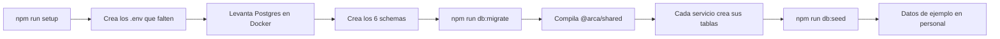
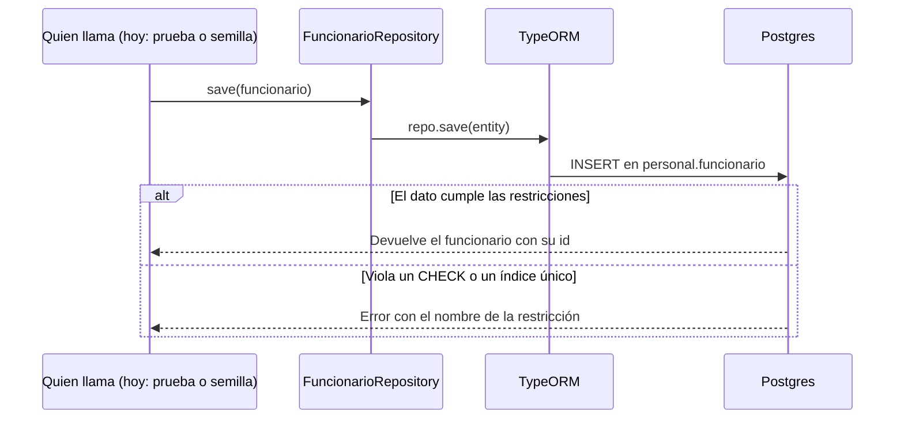
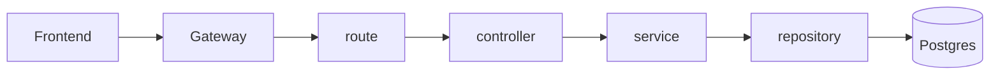
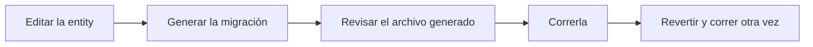

# HU-02: qué se implementó y cómo funciona

Guía para el equipo. Explica qué dejó lista la HU-02, cómo levantarlo y qué camino sigue cada operación.

## 1. Resumen

La HU-02 construye la **capa de datos** de todos los servicios: las tablas, las migraciones y las clases para leer y guardar. También dejó la estructura de carpetas de `backend-arca` y `frontend-arca`.

| Ya existe | Todavía no existe |
|---|---|
| Estructura de los 5 microservicios, el gateway y el frontend | Endpoints de negocio, salvo `GET /health` |
| 6 schemas y 20 tablas, con sus restricciones | Services, controllers y routes |
| 20 repositories con `findById`, `findAll` y `save` | Login, JWT y enrutamiento del gateway |
| Semilla con 5 funcionarios de ejemplo | Base en Supabase y roles por schema (HU-03) |
| Pruebas de cada repository | Pantallas del frontend |

Hoy el sistema no atiende peticiones de negocio. Las HU siguientes construyen sobre esta capa.

## 2. Cómo levantarlo

Necesitas Node 20 o superior y Docker Desktop abierto. Desde la raíz de `backend-arca`:

```bash
npm install          # instala todo y compila @arca/shared
npm run setup        # crea los .env y levanta la base local
npm run db:migrate   # crea las 20 tablas
npm run db:seed      # carga los datos de ejemplo
npm test             # opcional: corre todas las pruebas
npm run dev --workspace=ms-personal   # levanta el servicio de tu HU
```

No hay que editar ningún `.env`. Los valores de desarrollo ya vienen listos, y la base local usa el puerto **5433** para no chocar con un Postgres instalado en tu máquina.

El frontend va aparte, desde `frontend-arca`: `npm install` y `npm run dev` (abre en `http://localhost:5173`).

## 3. Mapa del sistema

Cada servicio es dueño de un schema. Ningún servicio lee las tablas de otro: si necesita un dato ajeno, lo pide por API.

| Servicio | Puerto | Schema | Tablas |
|---|---|---|---|
| `gateway` | 8080 | `auditoria` | `evento` |
| `ms-auth` | 3001 | `autenticacion` | `usuario` |
| `ms-personal` | 3002 | `personal` | `area`, `cargo`, `funcionario`, `asignacion_laboral` |
| `ms-vacaciones` | 3003 | `vacaciones` | `feriado`, `solicitud_vacacion` |
| `ms-contratos` | 3004 | `contratos` | `plantilla`, `plantilla_version`, `contrato`, `contrato_pdf`, `correlativo` |
| `ms-boletas` | 3005 | `boletas` | `concepto`, `periodo`, `novedad`, `boleta`, `boleta_detalle`, `boleta_pdf`, `correlativo` |

El detalle de cada columna está en [data-model.md](data-model.md).

### Dónde va cada cosa

```
backend-arca/
  docs/Sprints/        documentación por sprint
  packages/shared/     enums y numericTransformer, usados por todos
  gateway/             API Gateway
  services/ms-*/
    src/
      routes/ controllers/ services/   ← los llenan las siguientes HU
      repositories/    único lugar donde se usa TypeORM
      entities/        una clase por tabla
      migrations/      cambios de la base, generados por TypeORM
      data-source.ts   conexión a la base
    tests/
```

## 4. Flujo de cada operación

### 4.1 Preparar el entorno de cero



### 4.2 Guardar y leer un dato

Este es el camino que ya funciona. Los services de las próximas HU llamarán al repository de la misma forma.



La base es la última defensa: un dato inválido se rechaza aunque el service tenga un error. Por ejemplo, si intentas guardar dos asignaciones vigentes para un funcionario, el error dice `ux_asignacion_vigente`.

### 4.3 Atender una petición (lo que construirán las próximas HU)

Hoy solo existe el último tramo, desde el repository hasta Postgres.



### 4.4 Buscar un usuario para el login

`password_hash` nunca se devuelve en una consulta normal, para que no se filtre por accidente en una respuesta.

| Método | ¿Trae `passwordHash`? | Para qué |
|---|---|---|
| `UsuarioRepository.findById(id)` | No | Uso normal |
| `UsuarioRepository.findByEmailWithPassword(email)` | Sí | Solo para validar el login (HU-05) |

Los PDF funcionan igual: `findById` de `contrato_pdf` y `boleta_pdf` no carga `contenido`. Quien necesite el archivo debe agregar su propia consulta.

### 4.5 Cargar la semilla

`npm run db:seed` corre `src/seeds/dev.seed.ts` de `ms-personal`, en este orden: áreas, cargos, funcionarios y asignaciones. Antes de insertar revisa si el dato ya existe (por `codigo`, por área y nombre, o por `ci`), así que se puede correr varias veces sin duplicar.

| CI | Estado | Ingreso | Cargo | Sirve para probar |
|---|---|---|---|---|
| 9000001 | `EN_PRUEBA` | 01/09/2026 | Operador | Período de prueba |
| 9000002 | `EN_PRUEBA` | 01/10/2026 | Asistente Administrativo | Período de prueba de 60 días |
| 9000003 | `RATIFICADO` | 01/03/2024 | Desarrollador | Vacaciones (más de 1 año) |
| 9000004 | `RATIFICADO` | 02/03/2026 | Supervisor de Operaciones | Ratificado con menos de 1 año |
| 9000005 | `BAJA` | 03/02/2025 | Jefe de RRHH | Baja, con asignación cerrada |

La semilla no crea usuarios, así que quien haga la HU-05 debe crear los suyos. `registrado_por` usa el id fijo `00000000-0000-0000-0000-000000000001`, que no corresponde a un usuario real.

### 4.6 Cambiar una tabla

Nunca cambies la base a mano, y `synchronize` siempre queda en `false`.



Desde la carpeta del servicio, poniendo un nombre que describa el cambio:

```bash
npx typeorm-ts-node-commonjs migration:generate src/migrations/AgregaCampoX -d src/data-source.ts
npm run migration:run
npm run migration:revert
npm run migration:run
```

El script `npm run migration:generate` siempre usa el nombre `InitialSchema`, así que para cambios nuevos usa el comando de arriba.

### 4.7 Correr las pruebas

`npm test` corre todas las pruebas de todos los servicios y **necesita la base levantada y migrada**. Si fallan con error de conexión, corre `npm run db:up` y `npm run db:migrate`.

Cada prueba de repository guarda un dato, lo lee y comprueba que la base rechaza un dato inválido. Al terminar borra lo que creó, así que no afecta la semilla.

Para empezar de cero: `npm run db:reset`, `npm run db:migrate` y `npm run db:seed`.

## 5. Reglas para escribir código

| Tema | Regla | Motivo |
|---|---|---|
| Fechas de negocio | `string` con formato `'YYYY-MM-DD'`, nunca `Date` | Bolivia es UTC-4: un `Date` se corre un día |
| Instantes | `Date` (`timestamptz`) | Sí necesitan hora exacta |
| Dinero | `numeric` con `numericTransformer` | Sin él, TypeORM devuelve `string` |
| Enums | Se declaran solo en `packages/shared/src/enums.ts` | Una sola fuente de valores |
| Datos de otro servicio | Columna `uuid` sin FK, y se validan por API | Los schemas son independientes |
| TypeORM | Solo en `repositories/` | Los services no lo usan directo |
| Repositories | Cada HU agrega las consultas que necesite | La base solo trae `findById`, `findAll` y `save` |
| Cambios en `packages/shared` | Después corre `npm run build --workspace=@arca/shared` | Los servicios usan la versión compilada |

Si dos tablas de un schema comparten enum, TypeORM genera dos veces el `CREATE TYPE` y la migración falla. Hay que borrar a mano el `CREATE` y el `DROP` repetidos; el `DROP` que se conserva es el que va después de borrar la última tabla que usa el tipo. Ya pasó con `tipo_concepto` en `ms-boletas`.

## 6. Por dónde empezar según tu HU

| HU | Servicio | Qué ya tienes | Qué te toca |
|---|---|---|---|
| HU-03 | Todos | Workspace npm, plantilla con capas y `/health`, `DataSource`, Jest y Supertest, un Dockerfile por servicio y `docker-compose.yml` | Revisar lo ya hecho contra sus subtareas. Falta la base en Supabase con roles y `GRANT` por schema, el proxy del gateway con CORS y request-id, ESLint y el pipeline de CI |
| HU-04 | `frontend-arca` | Estructura de `features/` por módulo y `services/api.ts` | La base del frontend |
| HU-05, HU-06 | `ms-auth` | `UsuarioRepository` con `findByEmailWithPassword` | Login, JWT, bloqueo por intentos y usuarios iniciales |
| HU-07 | `ms-personal` | `AreaRepository`, `CargoRepository` | CRUD de áreas y cargos |
| HU-08 a HU-12 | `ms-personal` | `FuncionarioRepository`, `AsignacionLaboralRepository` y la semilla | Alta, historial, ratificación y baja |
| HU-13 a HU-16 | `ms-vacaciones` | `FeriadoRepository`, `SolicitudVacacionRepository` | Semilla de feriados, saldo, solicitudes y aprobación |
| HU-17 a HU-19 | `ms-contratos` | Repositories de plantilla, contrato, PDF y correlativo | Plantillas, generación y descarga |
| HU-20 a HU-23 | `ms-boletas` | Repositories de concepto, período, novedad, boleta, PDF y correlativo | Semilla de conceptos, cálculo, emisión y el trigger de inmutabilidad |
| HU-24 | `gateway` | `EventoRepository` | Registrar la auditoría en cada petición |
| HU-25 | `gateway` | Puerto y URLs de los servicios en `.env.example` | Dashboard: endpoints `/internal/stats` y agregador |
| HU-27 | Todos | La semilla de `ms-personal` como ejemplo | Semilla de demo por servicio y comando de reinicio |

## 7. Decisiones y pendientes

Decisiones que conviene conocer:

- **El schema de `ms-auth` se llama `autenticacion`, no `auth`.** Supabase ya usa `auth` para su propio servicio. La tabla sigue siendo `usuario` y el servicio sigue siendo `ms-auth`.
- **Los ids usan `gen_random_uuid()`**, que viene incluida en Postgres, en lugar de la extensión `uuid-ossp`.
- **El gateway también tiene repository**, para que TypeORM siga usándose solo en esa capa.
- **El gateway y `docker-compose.yml` apuntan a la base local.** La HU-03 cambia `DATABASE_URL` cuando conecte Supabase.

Pendientes:

- [ ] **HU-03:** correr las migraciones y la semilla en Supabase por el Session pooler. Todo se probó solo en Postgres local.
- [ ] **HU-03:** cambiar `JWT_SECRET` e `INTERNAL_API_KEY`. Los actuales solo sirven para desarrollo.
- [ ] **Equipo:** decidir si `usuarioId` sale del contrato interno de `Funcionario`. Está en la sección "Dudas" de [data-model.md](data-model.md), junto con las demás notas.

## 8. Documentos relacionados

| Documento | Contenido |
|---|---|
| [data-model.md](data-model.md) | Todas las tablas y columnas, y las dudas abiertas |
| [HU-02_HANDOFF_CLAUDE_CODE.md](HU-02_HANDOFF_CLAUDE_CODE.md) | Alcance y reglas con que se hizo esta HU |
| [HU-01_Arquitectura_Contexto_Equipo.md](../../../HU-01_Arquitectura_Contexto_Equipo.md) | Arquitectura y convenciones del equipo |
| [adr/](../adr/) | Decisiones de arquitectura |
| [api/internal-contracts.openapi.yaml](../../../api/internal-contracts.openapi.yaml) | Contratos entre servicios |
| [c4/](../../../c4/) | Diagramas C4 |
| [supuestos-negocio.md](../../../supuestos-negocio.md) | Supuestos de negocio |
| [BacklogOficial.csv](../../../BacklogOficial.csv) | Backlog del proyecto, con las HU y sus tareas |
