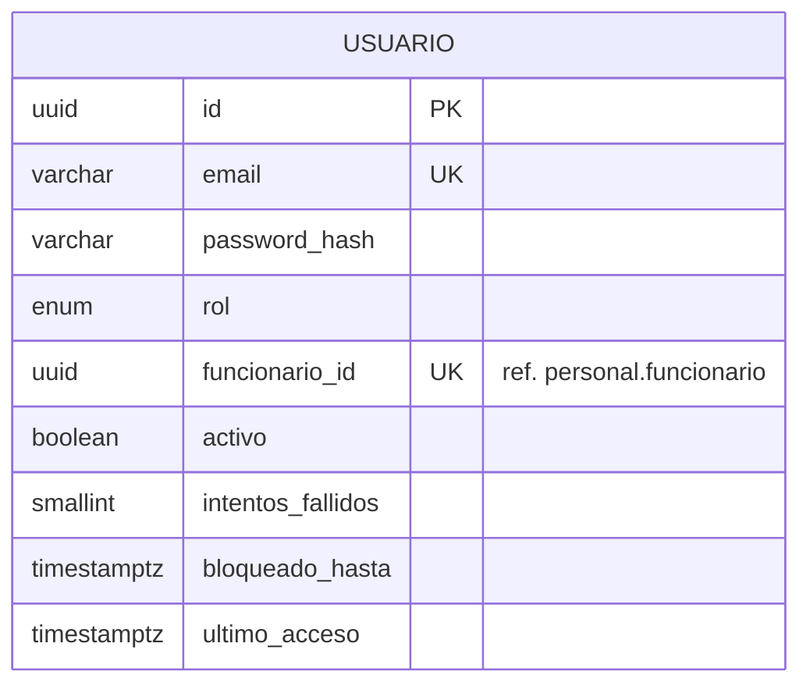
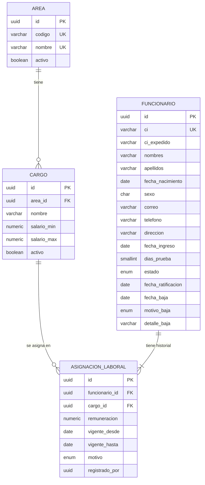
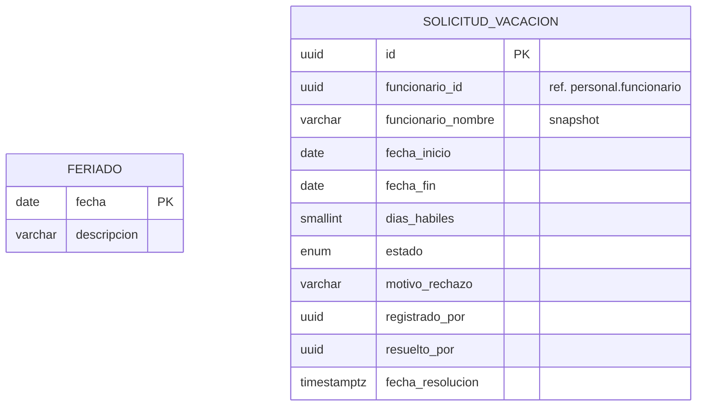
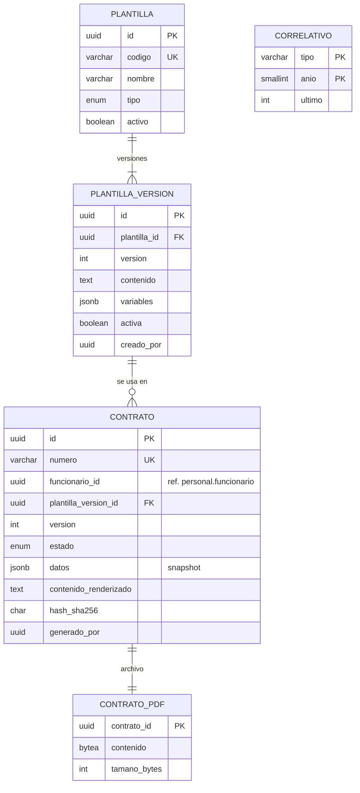
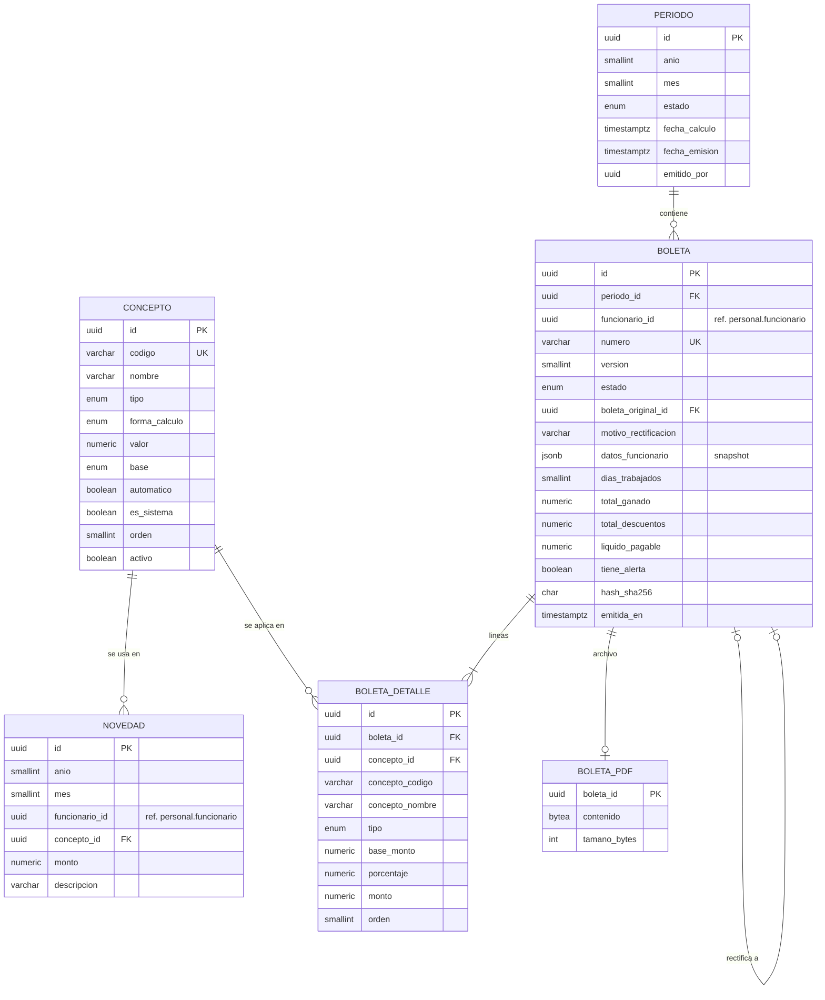
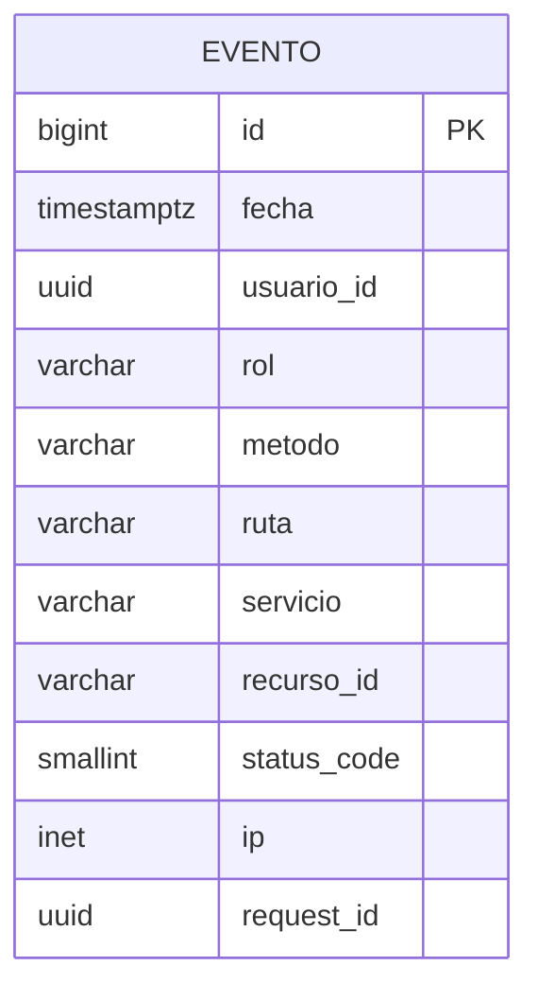

# Modelo de datos – Sistema de Gestión Humana ARCA (HU-02)

**Base:** una instancia PostgreSQL en Supabase, 6 schemas (ADR-002). Cada schema pertenece a un solo servicio y tiene su propio rol de BD.
**ORM:** TypeORM con migraciones (ADR-005). Sin SQL crudo, salvo el trigger de inmutabilidad de boletas (HU-22).

| Schema | Dueño | Tablas |
|---|---|---|
| `autenticacion` | ms-auth | `usuario` |
| `personal` | ms-personal | `area`, `cargo`, `funcionario`, `asignacion_laboral` |
| `vacaciones` | ms-vacaciones | `feriado`, `solicitud_vacacion` |
| `contratos` | ms-contratos | `plantilla`, `plantilla_version`, `contrato`, `contrato_pdf`, `correlativo` |
| `boletas` | ms-boletas | `concepto`, `periodo`, `novedad`, `boleta`, `boleta_detalle`, `boleta_pdf`, `correlativo` |
| `auditoria` | api-gateway | `evento` |

---

## 1. Reglas generales (aplican a todos los schemas)

1. **Sin llaves foráneas entre schemas.** Una referencia a otro servicio (`funcionario_id` en vacaciones, contratos o boletas; `usuario_id` en cualquier tabla) es una columna `uuid` con índice, validada por API. Dentro de un mismo schema sí hay FK.
2. **Claves primarias `uuid`** generadas por la BD (`@PrimaryGeneratedColumn('uuid')`), igual que en los contratos OpenAPI. Única excepción: `auditoria.evento`, que usa `bigint` autoincremental porque es una bitácora de alto volumen ordenada por inserción.
3. **Nombres:** tablas y columnas en `snake_case` y singular en la BD; propiedades en `camelCase` en TypeScript. Se mapean con `SnakeNamingStrategy` (paquete `typeorm-naming-strategies`), configurado en el `DataSource` de cada servicio. Nadie escribe `name:` a mano en `@Column`.
4. **Dinero:** `numeric(12,2)`, siempre en bolivianos. TypeORM devuelve `numeric` como `string`; se usa un `NumericTransformer` común de `packages/shared` que lo convierte a `number`. Los porcentajes usan `numeric(7,4)`.
5. **Fechas de negocio** (ingreso, vigencias, vacaciones, baja): tipo `date`, y en TypeScript se manejan como `string` `'YYYY-MM-DD'`. No se convierten a `Date` de JavaScript: Bolivia es UTC-4 y un `Date` a medianoche se corre al día anterior.
6. **Instantes** (creación, emisión, resolución, login): `timestamptz`.
7. **Auditoría de fila:** toda tabla editable tiene `created_at` y `updated_at` (`@CreateDateColumn`, `@UpdateDateColumn`). Las tablas inmutables solo tienen `created_at`.
8. **Quién hizo la acción:** columnas `*_por` (`registrado_por`, `resuelto_por`, `generado_por`, etc.) guardan el `uuid` del usuario que llega en `X-User-Id`. No llevan FK porque el usuario vive en `autenticacion`.
9. **Enums:** se declaran como `enum` de Postgres desde TypeORM (`type: 'enum'`). Los valores van en MAYÚSCULAS y son los mismos que en el OpenAPI.
10. **Snapshots:** cuando un documento debe quedar como fue emitido (contrato, boleta) o cuando una lista se muestra sin llamar a otro servicio (bandeja de vacaciones), se copia el dato en ese momento. El snapshot no se actualiza si cambia el original.
11. **Migraciones:** cada `DataSource` usa `schema: '<su schema>'` y `migrationsTableName: 'migrations'`, así la tabla de control de migraciones queda dentro del schema del servicio y nadie pisa las migraciones de otro.

---

## 2. Schema `autenticacion` (ms-auth)



### `usuario`

| Columna | Tipo | Nulo | Regla | HU |
|---|---|---|---|---|
| `id` | uuid | no | PK | |
| `email` | varchar(150) | no | único; se guarda en minúsculas | HU-05, HU-06 |
| `password_hash` | varchar(100) | no | bcrypt; nunca se devuelve en respuestas (`select: false`) | HU-05 |
| `rol` | enum `ADMIN`, `RRHH`, `DIRECCION`, `FUNCIONARIO` | no | | HU-05 |
| `funcionario_id` | uuid | sí | único (una cuenta por funcionario) | HU-06 CA-04 |
| `activo` | boolean | no | default `true` | HU-05 CA-04, HU-06, HU-12 |
| `intentos_fallidos` | smallint | no | default 0; se reinicia al entrar bien | HU-05 CA-05 |
| `bloqueado_hasta` | timestamptz | sí | 15 min tras 5 fallos | HU-05 CA-05 |
| `ultimo_acceso` | timestamptz | sí | | |
| `created_at`, `updated_at` | timestamptz | no | | |

**Restricciones:**
- `CHECK (rol <> 'FUNCIONARIO' OR funcionario_id IS NOT NULL)`: un usuario FUNCIONARIO siempre está vinculado. Un usuario RRHH o DIRECCION *puede* estar vinculado si también es empleado; eso permite la regla "nadie aprueba su propia solicitud" (HU-15 CA-05).
- El estado `ACTIVO`/`INACTIVO` del contrato `PATCH /internal/usuarios/:id/estado` se traduce a `activo = true/false`.

> Los roles son un enum y no una tabla: el kata define 4 roles fijos y los permisos viven en el código (`requireRole`). Si más adelante se necesitan permisos editables, se migra a tabla.

---

## 3. Schema `personal` (ms-personal)



### `area`

| Columna | Tipo | Nulo | Regla | HU |
|---|---|---|---|---|
| `id` | uuid | no | PK | |
| `codigo` | varchar(20) | no | único | HU-07 CA-01 |
| `nombre` | varchar(100) | no | único | HU-07 CA-01 |
| `activo` | boolean | no | default `true` | HU-07 CA-05 |
| `created_at`, `updated_at` | timestamptz | no | | |

### `cargo`

| Columna | Tipo | Nulo | Regla | HU |
|---|---|---|---|---|
| `id` | uuid | no | PK | |
| `area_id` | uuid | no | FK → `area.id`; no se cambia después de creado | HU-07 CA-02 |
| `nombre` | varchar(100) | no | único dentro del área: `UNIQUE (area_id, nombre)` | HU-07 |
| `salario_min` | numeric(12,2) | no | `> 0` | HU-07 CA-03 |
| `salario_max` | numeric(12,2) | no | `CHECK (salario_min <= salario_max)` | HU-07 CA-03 |
| `activo` | boolean | no | default `true` | HU-07 CA-04, CA-05 |
| `created_at`, `updated_at` | timestamptz | no | | |

### `funcionario`

| Columna | Tipo | Nulo | Regla | HU |
|---|---|---|---|---|
| `id` | uuid | no | PK | |
| `ci` | varchar(15) | no | único | HU-08 CA-02 |
| `ci_expedido` | varchar(2) | no | `LP, CB, SC, OR, PT, CH, TJ, BE, PD` | HU-08 CA-01 |
| `nombres` | varchar(100) | no | | |
| `apellidos` | varchar(100) | no | | |
| `fecha_nacimiento` | date | no | 18 años o más a la fecha de ingreso (se valida en el service) | HU-08 CA-03 |
| `sexo` | char(1) | no | `M` o `F` | HU-08 CA-01 |
| `correo` | varchar(150) | sí | | HU-10 CA-07 |
| `telefono` | varchar(20) | sí | | HU-10 CA-07 |
| `direccion` | varchar(200) | sí | | HU-10 CA-07 |
| `fecha_ingreso` | date | no | no se edita | HU-08, HU-13 |
| `dias_prueba` | smallint | no | default 90; `CHECK (dias_prueba BETWEEN 1 AND 90)` | HU-08 CA-05, HU-11, HU-18 |
| `estado` | enum `EN_PRUEBA`, `RATIFICADO`, `BAJA` | no | default `EN_PRUEBA` | HU-08, HU-11, HU-12 |
| `fecha_ratificacion` | date | sí | | HU-11 CA-03 |
| `fecha_baja` | date | sí | `>= fecha_ingreso` | HU-12 CA-04 |
| `motivo_baja` | enum `RENUNCIA`, `DESPIDO`, `FIN_CONTRATO`, `NO_RATIFICADO`, `OTRO` | sí | | HU-12 CA-01 |
| `detalle_baja` | varchar(300) | sí | obligatorio si el motivo es `OTRO` | HU-12 CA-01 |
| `created_at`, `updated_at` | timestamptz | no | | |

**Restricciones (CHECK):**
- `estado <> 'RATIFICADO' OR fecha_ratificacion IS NOT NULL`
- `estado <> 'BAJA' OR (fecha_baja IS NOT NULL AND motivo_baja IS NOT NULL)`
- `fecha_baja IS NULL OR fecha_baja >= fecha_ingreso`
- `motivo_baja <> 'OTRO' OR detalle_baja IS NOT NULL`

Un funcionario ratificado que luego se da de baja conserva su `fecha_ratificacion`.

### `asignacion_laboral` (historial de área, cargo y remuneración)

| Columna | Tipo | Nulo | Regla | HU |
|---|---|---|---|---|
| `id` | uuid | no | PK | |
| `funcionario_id` | uuid | no | FK → `funcionario.id` | |
| `cargo_id` | uuid | no | FK → `cargo.id` | HU-08, HU-10 |
| `remuneracion` | numeric(12,2) | no | `> 0`; dentro de la banda del cargo (se valida en el service) | HU-08 CA-04, HU-10 CA-04 |
| `vigente_desde` | date | no | | HU-10 CA-01 |
| `vigente_hasta` | date | sí | `NULL` = asignación vigente | HU-10 CA-02 |
| `motivo` | enum `INGRESO`, `ASCENSO`, `TRASLADO`, `INCREMENTO`, `CORRECCION` | no | la primera siempre es `INGRESO` | HU-08 CA-06, HU-10 CA-01 |
| `registrado_por` | uuid | no | usuario que hizo el cambio | |
| `created_at` | timestamptz | no | la fila no se edita, salvo para cerrarla | |

**Restricciones:**
- Índice único parcial: `UNIQUE (funcionario_id) WHERE vigente_hasta IS NULL` → solo una asignación vigente por funcionario (HU-02 CA-03, HU-10 CA-06). En TypeORM: `@Index(['funcionarioId'], { unique: true, where: '"vigente_hasta" IS NULL' })`.
- `CHECK (vigente_hasta IS NULL OR vigente_hasta >= vigente_desde)`.

**Decisión de diseño:** la asignación guarda el **cargo** y no el área. El área sale de `cargo.area_id`. Guardar las dos permitiría una fila con un cargo de Finanzas y un área de Sistemas; así eso no puede pasar. Cambiar de área es cambiar a un cargo de otra área.

**Al cerrar (HU-10):** la vigente recibe `vigente_hasta = nuevo vigente_desde − 1 día` y se crea la nueva, en la misma transacción. Por eso la nueva fecha debe ser **posterior** a la `vigente_desde` actual. **Al dar de baja (HU-12):** la vigente recibe `vigente_hasta = fecha_baja` y no se crea otra.

---

## 4. Schema `vacaciones` (ms-vacaciones)



**No hay tabla de saldo.** El saldo se calcula cada vez (HU-02 CA-05, HU-13): `15 × gestiones cumplidas − días APROBADOS − días PENDIENTES`. Las gestiones salen de `fecha_ingreso`, que viene de `ms-personal`.

### `feriado`

| Columna | Tipo | Nulo | Regla | HU |
|---|---|---|---|---|
| `fecha` | date | no | PK (un feriado por día) | HU-13 CA-05 |
| `descripcion` | varchar(100) | no | | |

Semilla: feriados nacionales de Bolivia 2026 y 2027 (HU-13 T3).

### `solicitud_vacacion`

| Columna | Tipo | Nulo | Regla | HU |
|---|---|---|---|---|
| `id` | uuid | no | PK | |
| `funcionario_id` | uuid | no | índice | HU-14 |
| `funcionario_nombre` | varchar(200) | no | snapshot para la bandeja y el calendario | HU-15 CA-01, HU-16 CA-04 |
| `fecha_inicio` | date | no | | HU-14 CA-01 |
| `fecha_fin` | date | no | `CHECK (fecha_fin >= fecha_inicio)` | HU-14 CA-05 |
| `dias_habiles` | smallint | no | `> 0`; se calcula al crear y no cambia | HU-14 CA-01, CA-05 |
| `estado` | enum `PENDIENTE`, `APROBADA`, `RECHAZADA` | no | default `PENDIENTE` | HU-14 CA-06, HU-15 |
| `motivo_rechazo` | varchar(300) | sí | obligatorio si `RECHAZADA` | HU-15 CA-03 |
| `registrado_por` | uuid | no | usuario que creó la solicitud | HU-14 CA-07 |
| `resuelto_por` | uuid | sí | | HU-15 CA-07 |
| `fecha_resolucion` | timestamptz | sí | | HU-15 CA-07 |
| `created_at`, `updated_at` | timestamptz | no | | |

**Restricciones (CHECK):**
- `estado <> 'RECHAZADA' OR motivo_rechazo IS NOT NULL`
- `estado = 'PENDIENTE' OR (resuelto_por IS NOT NULL AND fecha_resolucion IS NOT NULL)`

**Índices:** `(funcionario_id, estado)` para el saldo y el solapamiento; `(estado, created_at)` para la bandeja.

**Solapamiento (HU-14 CA-04):** lo valida el service con la consulta del repository (rango `[fecha_inicio, fecha_fin]` contra solicitudes `PENDIENTE` o `APROBADA` del mismo funcionario). No se usa una restricción de exclusión de Postgres porque requeriría SQL crudo.

---

## 5. Schema `contratos` (ms-contratos)



### `plantilla`

| Columna | Tipo | Nulo | Regla | HU |
|---|---|---|---|---|
| `id` | uuid | no | PK | |
| `codigo` | varchar(30) | no | único | HU-17 CA-01 |
| `nombre` | varchar(150) | no | | HU-17 CA-01 |
| `tipo` | enum `INDEFINIDO`, `PLAZO_FIJO` | no | | HU-17 CA-01 |
| `activo` | boolean | no | default `true` | |
| `created_at`, `updated_at` | timestamptz | no | | |

### `plantilla_version` (inmutable)

| Columna | Tipo | Nulo | Regla | HU |
|---|---|---|---|---|
| `id` | uuid | no | PK | |
| `plantilla_id` | uuid | no | FK → `plantilla.id` | |
| `version` | int | no | `UNIQUE (plantilla_id, version)`; empieza en 1 | HU-17 CA-05 |
| `contenido` | text | no | HTML con variables Handlebars | HU-17 CA-02 |
| `variables` | jsonb | no | lista de variables usadas, para validar | HU-17 CA-04 |
| `activa` | boolean | no | índice único parcial `UNIQUE (plantilla_id) WHERE activa` | HU-17 CA-06 |
| `creado_por` | uuid | no | | |
| `created_at` | timestamptz | no | | |

Editar una plantilla = crear una versión nueva activa y desactivar la anterior, en una transacción. El contenido de una versión no se modifica nunca (HU-17 CA-05).

### `contrato` (inmutable salvo `estado`)

| Columna | Tipo | Nulo | Regla | HU |
|---|---|---|---|---|
| `id` | uuid | no | PK | |
| `numero` | varchar(20) | no | único, `CT-AAAA-NNNN` | HU-18 CA-07 |
| `funcionario_id` | uuid | no | índice | HU-18, HU-19 |
| `plantilla_version_id` | uuid | no | FK → `plantilla_version.id` | HU-18 CA-04 |
| `version` | int | no | versión del contrato de ese funcionario; `UNIQUE (funcionario_id, version)` | HU-18 CA-06 |
| `estado` | enum `VIGENTE`, `REEMPLAZADO` | no | índice único parcial `UNIQUE (funcionario_id) WHERE estado = 'VIGENTE'` | HU-18 CA-06 |
| `datos` | jsonb | no | snapshot de las variables usadas (nombre, CI, cargo, área, remuneración, fecha de ingreso, días de prueba…) | HU-18 CA-04 |
| `contenido_renderizado` | text | no | HTML final | HU-18 CA-04 |
| `hash_sha256` | char(64) | no | hash del PDF | HU-18 CA-04, HU-19 CA-03 |
| `generado_por` | uuid | no | | |
| `created_at` | timestamptz | no | | |

### `contrato_pdf`

| Columna | Tipo | Nulo | Regla | HU |
|---|---|---|---|---|
| `contrato_id` | uuid | no | PK y FK → `contrato.id` (1 a 1) | ADR-006 |
| `contenido` | bytea | no | `select: false` en la entity | ADR-006, HU-19 |
| `tamano_bytes` | int | no | | |

### `correlativo`

| Columna | Tipo | Nulo | Regla |
|---|---|---|---|
| `tipo` | varchar(10) | no | PK compuesta; aquí siempre `CT` |
| `anio` | smallint | no | PK compuesta |
| `ultimo` | int | no | último número entregado |

Para sacar el siguiente número: dentro de la transacción del contrato, leer la fila con bloqueo (`setLock('pessimistic_write')` de TypeORM), sumar 1 y guardar. Así dos contratos generados al mismo tiempo no reciben el mismo número.

---

## 6. Schema `boletas` (ms-boletas)



### `concepto`

| Columna | Tipo | Nulo | Regla | HU |
|---|---|---|---|---|
| `id` | uuid | no | PK | |
| `codigo` | varchar(20) | no | único | HU-20 CA-01 |
| `nombre` | varchar(100) | no | | HU-20 CA-01 |
| `tipo` | enum `HABER`, `DESCUENTO` | no | | HU-20 CA-01 |
| `forma_calculo` | enum `SISTEMA`, `MONTO_FIJO`, `PORCENTAJE` | no | `SISTEMA` solo para el haber básico | HU-20 CA-01, CA-03 |
| `valor` | numeric(12,4) | sí | monto en Bs o porcentaje | HU-20 CA-02 |
| `base` | enum `HABER_BASICO`, `TOTAL_GANADO` | sí | solo para `PORCENTAJE` | HU-20 CA-01 |
| `automatico` | boolean | no | `true` = se aplica a todos; `false` = solo por novedad | HU-20 CA-01, CA-05 |
| `es_sistema` | boolean | no | `true` = no se edita ni desactiva | HU-20 CA-03 |
| `orden` | smallint | no | orden en la boleta | HU-20 CA-01 |
| `activo` | boolean | no | default `true` | HU-20 CA-04 |
| `created_at`, `updated_at` | timestamptz | no | | |

**Restricciones (CHECK):**
- `forma_calculo <> 'PORCENTAJE' OR (valor BETWEEN 0 AND 100 AND base IS NOT NULL)`
- `forma_calculo <> 'MONTO_FIJO' OR valor > 0`
- `forma_calculo <> 'SISTEMA' OR (valor IS NULL AND base IS NULL)`

**Semilla:** `HABER_BASICO` (HABER, SISTEMA, automático, es_sistema) y `APORTE_LABORAL` (DESCUENTO, PORCENTAJE 12,71 sobre TOTAL_GANADO, automático).

Un concepto usado en una boleta no se puede borrar: lo impide la FK desde `boleta_detalle` (`onDelete: 'RESTRICT'`). Solo se desactiva (HU-20 CA-04).

### `periodo`

| Columna | Tipo | Nulo | Regla | HU |
|---|---|---|---|---|
| `id` | uuid | no | PK | |
| `anio` | smallint | no | `UNIQUE (anio, mes)` | HU-21 CA-01 |
| `mes` | smallint | no | `CHECK (mes BETWEEN 1 AND 12)` | HU-21 CA-01 |
| `estado` | enum `BORRADOR`, `EMITIDO` | no | default `BORRADOR` | HU-21 CA-07, HU-22 CA-01 |
| `fecha_calculo` | timestamptz | sí | último cálculo | HU-21 |
| `fecha_emision` | timestamptz | sí | | HU-22 |
| `emitido_por` | uuid | sí | | HU-22 |
| `created_at`, `updated_at` | timestamptz | no | | |

### `novedad`

| Columna | Tipo | Nulo | Regla | HU |
|---|---|---|---|---|
| `id` | uuid | no | PK | |
| `anio` | smallint | no | | HU-20 CA-05 |
| `mes` | smallint | no | `CHECK (mes BETWEEN 1 AND 12)` | HU-20 CA-05 |
| `funcionario_id` | uuid | no | índice | HU-20 CA-05 |
| `concepto_id` | uuid | no | FK → `concepto.id`; debe ser un concepto no automático | HU-20 CA-05 |
| `monto` | numeric(12,2) | no | `> 0` | HU-20 CA-05 |
| `descripcion` | varchar(200) | sí | | |
| `registrado_por` | uuid | no | | |
| `created_at`, `updated_at` | timestamptz | no | | |

`UNIQUE (anio, mes, funcionario_id, concepto_id)`.

**Decisión de diseño:** la novedad se guarda por **año y mes**, no con FK a `periodo`. La HU-20 (novedades) va en el Sprint 2 y la HU-21 (abrir período) en el Sprint 3. Si la novedad colgara del período, no se podría registrar ninguna antes de abrirlo. El cálculo (HU-21) busca las novedades por `anio` y `mes` del período. Una novedad de un período ya `EMITIDO` no se puede crear ni editar (lo valida el service).

### `boleta`

| Columna | Tipo | Nulo | Regla | HU |
|---|---|---|---|---|
| `id` | uuid | no | PK | |
| `periodo_id` | uuid | no | FK → `periodo.id` | HU-21 |
| `funcionario_id` | uuid | no | índice | HU-21, HU-23 |
| `numero` | varchar(20) | sí | único; `BP-AAAAMM-NNNN`; se asigna al emitir | HU-22 CA-03 |
| `version` | smallint | no | default 1 | HU-22 CA-05 |
| `estado` | enum `BORRADOR`, `EMITIDA`, `RECTIFICADA` | no | default `BORRADOR` | HU-21, HU-22 |
| `boleta_original_id` | uuid | sí | FK → `boleta.id`: la boleta que esta rectifica | HU-02 CA-07, HU-22 CA-05 |
| `motivo_rectificacion` | varchar(300) | sí | | HU-22 CA-05 |
| `datos_funcionario` | jsonb | no | snapshot: nombre, CI, cargo, área, remuneración, fecha de ingreso | HU-22 CA-03 |
| `dias_trabajados` | smallint | no | `CHECK (dias_trabajados BETWEEN 0 AND 30)` | HU-21 CA-03 |
| `total_ganado` | numeric(12,2) | no | | HU-21 CA-08 |
| `total_descuentos` | numeric(12,2) | no | | HU-21 CA-08 |
| `liquido_pagable` | numeric(12,2) | no | | HU-21 CA-06 |
| `tiene_alerta` | boolean | no | `true` si el líquido es negativo | HU-21 CA-06, HU-22 CA-02 |
| `hash_sha256` | char(64) | sí | hash del PDF; se llena al emitir | HU-22 CA-03 |
| `emitida_en` | timestamptz | sí | | HU-22 |
| `created_at` | timestamptz | no | | |

**Restricciones:**
- Índice único parcial `UNIQUE (periodo_id, funcionario_id) WHERE estado <> 'RECTIFICADA'`: una sola boleta vigente por funcionario y período.
- `CHECK (estado = 'BORRADOR' OR (numero IS NOT NULL AND hash_sha256 IS NOT NULL AND emitida_en IS NOT NULL))`
- `CHECK (estado = 'BORRADOR' OR liquido_pagable >= 0)`
- `CHECK (version = 1 OR (boleta_original_id IS NOT NULL AND motivo_rectificacion IS NOT NULL))`
- **Trigger de inmutabilidad (HU-22, en una migración con `queryRunner.query`):** rechaza `DELETE` de una boleta `EMITIDA` o `RECTIFICADA`, y todo `UPDATE` de una boleta `EMITIDA` salvo cambiar `estado` a `RECTIFICADA`. El mismo trigger protege `boleta_detalle` y `boleta_pdf` cuando su boleta no está en `BORRADOR`.

**Ciclo de vida:** el cálculo (HU-21) borra y recrea las boletas `BORRADOR` del período. Emitir (HU-22) las pasa a `EMITIDA` y les asigna número, hash y PDF. Rectificar crea una nueva fila (`version + 1`, `boleta_original_id` = la que se corrige, estado `EMITIDA`) y la anterior pasa a `RECTIFICADA`.

### `boleta_detalle`

| Columna | Tipo | Nulo | Regla | HU |
|---|---|---|---|---|
| `id` | uuid | no | PK | |
| `boleta_id` | uuid | no | FK → `boleta.id`, `onDelete: 'CASCADE'` (solo borra borradores; el trigger protege las emitidas) | HU-21 CA-05 |
| `concepto_id` | uuid | no | FK → `concepto.id`, `onDelete: 'RESTRICT'` | HU-20 CA-04 |
| `concepto_codigo` | varchar(20) | no | snapshot | HU-21 CA-05 |
| `concepto_nombre` | varchar(100) | no | snapshot | HU-21 CA-05 |
| `tipo` | enum `HABER`, `DESCUENTO` | no | snapshot | |
| `base_monto` | numeric(12,2) | sí | sobre qué se calculó | HU-21 CA-05 |
| `porcentaje` | numeric(7,4) | sí | si fue porcentaje | HU-21 CA-05 |
| `monto` | numeric(12,2) | no | resultado redondeado a 2 decimales | HU-21 CA-05 |
| `orden` | smallint | no | | HU-21 CA-04 |

### `boleta_pdf`

| Columna | Tipo | Nulo | Regla | HU |
|---|---|---|---|---|
| `boleta_id` | uuid | no | PK y FK → `boleta.id` (1 a 1) | ADR-006 |
| `contenido` | bytea | no | `select: false` en la entity | ADR-006, HU-23 |
| `tamano_bytes` | int | no | | |

### `correlativo`

Igual que en `contratos`, con `tipo = 'BP'` y la clave `(tipo, anio)`; el mes va en el texto del número (`BP-AAAAMM-NNNN`), la secuencia es por año.

---

## 7. Schema `auditoria` (api-gateway)



### `evento` (solo inserción)

| Columna | Tipo | Nulo | Regla | HU |
|---|---|---|---|---|
| `id` | bigint | no | PK autoincremental | |
| `fecha` | timestamptz | no | default `now()` | HU-24 CA-02 |
| `usuario_id` | uuid | sí | `NULL` en un login fallido | HU-24 CA-02 |
| `rol` | varchar(20) | sí | | HU-24 CA-02 |
| `metodo` | varchar(7) | no | | HU-24 CA-01 |
| `ruta` | varchar(300) | no | sin query string con datos sensibles | HU-24 CA-03 |
| `servicio` | varchar(30) | no | | HU-24 CA-02 |
| `recurso_id` | varchar(64) | sí | | HU-24 CA-02 |
| `status_code` | smallint | no | | HU-24 CA-02 |
| `ip` | inet | sí | | HU-24 CA-02 |
| `request_id` | uuid | no | | HU-24 CA-02 |

**Índices:** `(fecha)`, `(usuario_id, fecha)`, `(servicio, fecha)`.
El rol de BD del gateway solo tiene `INSERT` y `SELECT` sobre esta tabla (HU-24 CA-04); ese permiso lo configura la HU-03.

---

## 8. Cómo se cruzan los servicios (sin FK)

| Columna | Está en | Apunta a | Se valida con |
|---|---|---|---|
| `usuario.funcionario_id` | autenticacion | personal.funcionario | `GET /internal/funcionarios/:id` al crear el usuario (HU-06) |
| `solicitud_vacacion.funcionario_id` | vacaciones | personal.funcionario | `GET /internal/funcionarios/:id` al solicitar (HU-14) |
| `contrato.funcionario_id` | contratos | personal.funcionario | `GET /internal/funcionarios/:id` al generar (HU-18) |
| `novedad.funcionario_id`, `boleta.funcionario_id` | boletas | personal.funcionario | `GET /internal/funcionarios?...` al calcular (HU-21) |
| `*_por`, `evento.usuario_id` | todos | autenticacion.usuario | viene en `X-User-Id`, ya validado por el gateway |

---

## 9. Mapeo a TypeORM (para que todos escriban igual)

```ts
// data-source.ts de cada servicio
new DataSource({
  type: 'postgres',
  url: process.env.DATABASE_URL,          // Session pooler de Supabase
  schema: process.env.DB_SCHEMA,          // 'personal', 'boletas', ...
  namingStrategy: new SnakeNamingStrategy(),
  entities: [__dirname + '/entities/*.entity.{ts,js}'],
  migrations: [__dirname + '/migrations/*.{ts,js}'],
  migrationsTableName: 'migrations',
  synchronize: false,
});
```

| En la BD | En la entity |
|---|---|
| `uuid` PK | `@PrimaryGeneratedColumn('uuid') id!: string;` |
| `numeric(12,2)` | `@Column('numeric', { precision: 12, scale: 2, transformer: numeric }) monto!: number;` |
| `date` | `@Column('date') fechaIngreso!: string;` |
| `timestamptz` | `@Column('timestamptz', { nullable: true }) fechaResolucion!: Date \| null;` |
| enum | `@Column({ type: 'enum', enum: EstadoFuncionario }) estado!: EstadoFuncionario;` |
| índice único parcial | `@Index(['funcionarioId'], { unique: true, where: '"vigente_hasta" IS NULL' })` |
| CHECK | `@Check('"salario_min" <= "salario_max"')` (nombres de columna en snake_case) |
| `bytea` del PDF | `@Column('bytea', { select: false }) contenido!: Buffer;` |

Los enums (`EstadoFuncionario`, `RolUsuario`, etc.) se definen una vez en `packages/shared/src/enums.ts`, porque varios aparecen en más de un servicio (por ejemplo, el estado del funcionario viaja en el contrato interno).

---

## 10. Dudas

| # | Tabla / columna | HU afectada | Duda |
|---|---|---|---|
| 1 | Schema `auth` completo | HU-03, HU-05, HU-06 | Supabase ya usa un schema `auth` para su propio servicio de autenticación y lo administra él. Las migraciones de `ms-auth` se probaron en Postgres local, donde el schema está libre, pero en Supabase podrían no poder crear tablas ahí, y mezclarían las nuestras con las suyas. Hay que probarlo al crear la base; si falla, el schema necesita otro nombre (por ejemplo `autenticacion`), y eso cambia este documento, ADR-002 y `DB_SCHEMA`. |
| 2 | `funcionario.ci`, `funcionario` sin `usuario_id` | HU-06, HU-08 | `internal-contracts.openapi.yaml` expone `documentoIdentidad` y `usuarioId`. Aquí la columna es `ci`, y el vínculo está en `usuario.funcionario_id`. El endpoint debe traducir `ci`, pero `usuarioId` no se puede sacar de `personal` sin llamar a `ms-auth`. Falta decidir si `usuarioId` sale del contrato. |
| 3 | `boleta_detalle`, `evento` | HU-21, HU-24 | El handoff dice que estas tablas llevan `created_at`, pero este documento no se lo pone: `boleta_detalle` no tiene fecha y `evento` usa `fecha`. Se siguió este documento. |
| 4 | `boleta_detalle.tipo`, `concepto.tipo` | HU-20, HU-21 | TypeORM genera dos veces `CREATE TYPE tipo_concepto` porque dos tablas comparten `enumName`, y la migración no corre. Se quitó a mano el `CREATE` y el `DROP` duplicados de la migración de `ms-boletas`, aunque la regla es no editarlas. `migration:generate --check` confirma que no hay diferencias con las entities. |
| 5 | Todas las PK `uuid` | HU-03 | Los `DataSource` usan `uuidExtension: 'pgcrypto'` y `installExtensions: false`, para que el default sea `gen_random_uuid()` (incluida en Postgres) y no `uuid_generate_v4()`. Esta última depende de la extensión `uuid-ossp`, que queda instalada en un solo schema y no la verían los roles de los demás servicios. |
